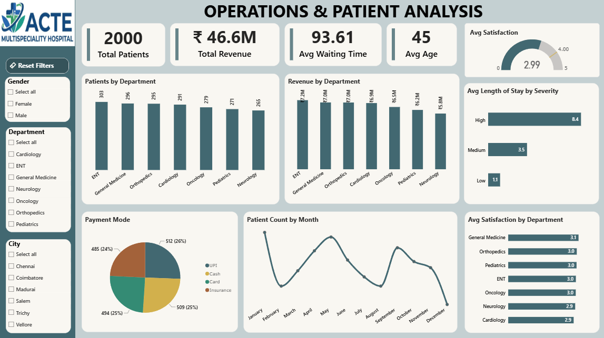

# hospital_patient_analytics
Analysis of 2,000 hospital patient visits using MySQL, Python and Power BI: readmissions, waiting times, satisfaction, costs and workload, with findings and recommendations.

